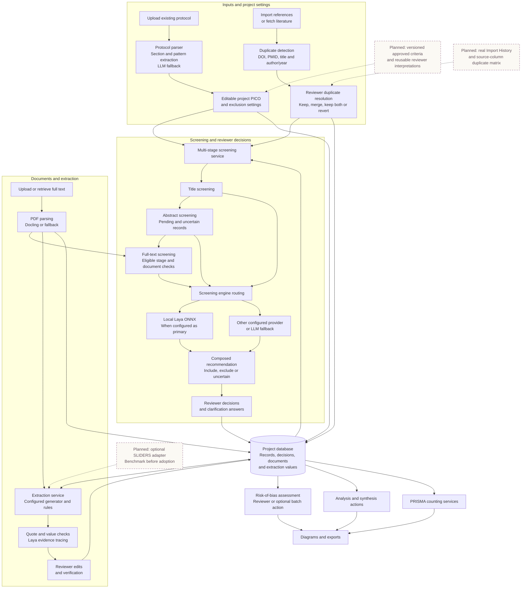
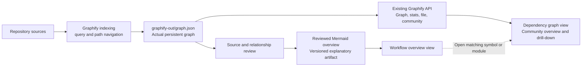

# Code Graph: Mermaid overview and actual Graphify explorer

Date: 2026-10-27 (Asia/Calcutta)
Status: planning only. No application implementation requested in this chat.
Related handoff: CODING_AGENT_HANDOFF_SCREENING_TO_PRISMA.md, work package 10.

## Purpose and confirmed decisions

Keep both views in Code Graph:

1. **Workflow overview**: a readable Mermaid diagram showing how the actual review application currently works, useful during the meeting.
2. **Dependency graph**: the actual persistent Graphify graph for symbol/file/community relationships and technical drill-down.

The Mermaid view complements Graphify; it must never replace or pretend to contain all Graphify nodes. Keep the raw graph and existing CLI navigation intact. Use exact internal symbol names only in authorized technical views; public review screens continue to follow the universal terminology policy.

## What the repository currently does

Source inspection and Graphify queries, not a live deployment verification:

- Frontend CodeGraphPage.tsx already requests code graph and statistics through api.ts. It defaults to 200 nodes and places nodes in a simple circle.
- backend/routers/graphify.py loads graphify-out/graph.json and provides graph, stats, file and community endpoints. The router is registered in backend/main.py.
- The graph endpoint has a maximum limit of 2685 nodes, below the current 11k-plus corpus. A limited graph response is a subset, not the full codebase.
- api.ts contains sample graph and statistics fallback responses. Trace when these activate; never silently label them actual repository data.
- The backend caches graph.json indefinitely. A normal refresh can keep showing an old graph after graphify update.
- RADEXTRACT_GRAPH_PATH is consulted only when the default file is missing. Define explicit configuration precedence instead of silently ignoring a supplied path.
- Workflow paths inspected include AIScreeningPipeline, jev_screener, jev_client, LayaModel, coded_extraction_service, laya_extraction_tracer, prisma2020_sync and the graph router. The diagram below is a functional source-based overview, not a claim that every feature is accurate or validated end to end.

## Current application overview — Mermaid

Solid arrows show implemented functional flow or data dependencies. They do not imply every step is automatic or verified. Reviewer actions and extraction/appraisal/export can be invoked separately; the full screening action itself runs title → abstract → full text. Dashed boxes show planned additions, not current integration.

### Important qualifications displayed with the overview

- Protocol extraction is not currently established as Laya-only; the inspected implementation uses sections/patterns and an LLM fallback.
- Laya is the required intended primary screening engine, but actual runtime settings/provider and fallback must be shown truthfully. Do not infer deployed provider from documentation alone.
- Screening has known accuracy concerns: search-string veto, incomplete criterion composition and text truncation. Diagram existence does not certify correctness.
- Structured extraction still has generator dependencies. Local evidence-tracer guardrails were patched earlier with mocked regression tests; a clinical accuracy benchmark remains pending.
- PRISMA has known pending-state and report-versus-study counting gaps.
- Rigor Scan is a separate reporting-check tool, not the screening engine. Its synthetic reader/chart/software-check gaps are tracked separately in the main handoff.
- Reference deduplication differs from SLIDERS reconciliation of extracted rows.
- Import History, source-column duplicate review and SLIDERS are planned/unverified, not completed workflow nodes.

## Two-view interface plan

### Workflow overview

- Add a clearly named Workflow overview tab next to Dependency graph. Preserve any existing review-data graph as a distinct view, not a substitute for the code graph.
- Render Mermaid locally using a pinned dependency or a reproducible pre-render step; never transmit internal source diagrams to a third-party rendering service.
- Start with the overview above. Add smaller drill-down diagrams for screening, extraction/provenance and PRISMA as needed rather than one unreadable giant diagram.
- Each diagram has a last-reviewed revision/date, legend, implemented/planned labels and accessible text equivalent. Keep current behavior and target architecture in separate diagrams.
- Labels link to verified source-file details or the matching Graphify neighborhood where mapping exists. Display a graceful unavailable state for unmapped nodes; never invent a call edge.
- Treat diagram descriptions and repository strings as untrusted text: use strict Mermaid security, escaped labels and no arbitrary HTML, script execution or external image loading.
- Include fit/reset, zoom/pan where appropriate, copy Mermaid source and local SVG export. Export must preserve labels and the status legend.

### Actual Graphify explorer

- Use graphify-out/graph.json as the authoritative dependency snapshot. Preserve node IDs, source paths/locations, relation types, community IDs, direction metadata and extracted/inferred provenance.
- Display actual full-corpus totals separately from displayed node/edge counts, together with built_at_commit, schema version and freshness/snapshot metadata. Graph and stats must describe the same snapshot.
- Begin with a community overview covering the whole corpus. Drill down to a community, source file, symbol neighborhood or relationship path without an arbitrary global cap making other nodes unreachable.
- Use stable layout and bounded progressive loading. Avoid animating all edges, labels on every edge or loading 11k DOM nodes at once. Provide search and an accessible selected-node/edge detail panel.
- Cache snapshots by file identity/version; atomically load updates and invalidate after re-indexing. Refresh updates both graph and stats without an API restart. If retaining a last-good snapshot during an error, label it stale explicitly.
- Missing/corrupt graph, backend outage and authorization failure remain visible errors with retry. Keep sample mode optional, separate and labelled; no silent demo fallback.
- Package or mount the real graph artifact in the backend deployment and configure its path. A static GitHub Pages build cannot read a local Windows repository path.
- Keep internal repository information within the intended technical access boundary. Do not put raw graph/source snapshots into public frontend assets by default. Changes to access control must follow the repository's high-stakes process.

## Graphify data flow — Mermaid

The Mermaid overview is maintained from verified source and graph evidence; automatic summarization is optional and must not be presented as verified without review. Current backend API/cache limitations above must be repaired before claiming live freshness.

## Ordered coding-agent tasks

1. Read AGENTS.md and relevant decisions; query Graphify before changing code. Preserve all current local work.
2. Reproduce current real-versus-demo response behavior; compare API metadata/totals and sampled IDs/edges against the file.
3. Fix explicit graph path configuration, snapshot metadata and cache invalidation with deterministic tests.
4. Implement full-corpus community aggregation and bounded file/community/neighborhood exploration by extending the existing router.
5. Preserve Dependency graph; add Workflow overview with the reviewed Mermaid source and safe local rendering.
6. Connect verified overview nodes to technical drill-down. Keep source and diagram revisions visible.
7. Apply Master Theme: wine, paper, fine plum outlines; Serifon headings, Work Sans controls and Quadraat reading explanations. Honor reduced motion and keyboard navigation.
8. Run API, component and actual browser tests. Re-index changed sources; update the diagram if implementation changes its depicted behavior.
9. Verify the intended deployed graph snapshot/revision. Report what is implemented, measured, pending or blocked; local completion is not deployment completion.

## Acceptance tests

- Both views exist, can be switched, and remain distinct; Graphify data is not replaced by Mermaid.
- Overview diagrams render valid syntax, have an accessible explanation and visibly distinguish planned additions from current behavior.
- Real API totals and representative node IDs/edges match the on-disk fixture; zero-node and filtered results remain truthful.
- Nodes beyond the former 2685 cap remain discoverable through navigation; full totals and subset totals are labelled correctly.
- Re-indexing/changing the graph then refreshing updates graph and stats consistently without API restart; stale/corrupt/missing snapshots are handled explicitly.
- Backend failure never becomes an unlabelled sample graph. A static-site-plus-backend test confirms the graph artifact is available at the configured deployment path.
- No dangling visible edges, invented call relationships or unsupported inference claims. Extracted versus inferred relationships are inspectable.
- Actual 11k-plus node corpus remains usable through aggregation/progressive loading. Record initial load/layout time, memory and navigation latency before choosing final performance limits.
- 1440px, 903px and 390px checks pass: no clipped essential controls, readable text, keyboard access, visible focus and reduced-motion handling.
- Copy source and SVG export work without external data transmission and include freshness/status context.
- Authorized technical access works; internal graph data is not accidentally published as public frontend assets.

## Scope boundary and handoff

This file is a standalone implementation plan for another coding agent. It does not authorize changes to screening decisions, clinical criteria, data extraction, graph source content or deployment access rules as a side effect of visualization work. The existing graph explorer and Mermaid diagrams must describe the application honestly while other accuracy repairs proceed in the main plan.
