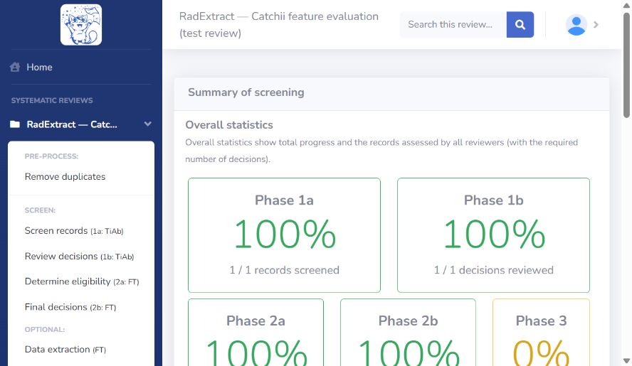

# Catchii detailed feature audit and RadExtract gap report

Inspection date: 11 October 2026 (Asia/Calcutta).

## Scope and evidence

I inspected the live Catchii account through the browser, using only the review created for this evaluation: [RadExtract — Catchii feature evaluation (test review)](https://app.catchii.org/review/12756). I opened all six Review Manager panels and all ten main review sections, including the available advanced options and menus. One explicitly synthetic record was added in dataset `synthetic_test`; it was advanced through the four screening/confirmation phases solely to expose record-level controls. It is not a publication or research evidence. Extraction remains incomplete.

I did not invite people, run AI, provide an API key, upload a PDF, delete data, finish the review, or change saved review configuration. I opened forms and menus without executing those actions. Offline synchronisation, populated duplicate groups, real disagreements, generated export files, PDF-dependent AI extraction, and gated AI run inputs were not tested. Therefore this is a detailed interface audit, not certification of every feature's successful operation.

The comparison uses the local web checkout at `radextract_web_repo` (remote: `https://github.com/vidhidhaduk05/ExtractExperimenting-web.git`) and selected core backend files. The parent folder's remote is `ExtractExperimenting.git`. Graphify was queried before code navigation; its results mostly identify the core repository's frontend rather than the nested web checkout. API definitions establish existing foundations, not completed or deployed functionality. No live RadExtract deployment was tested.

Status language in this report:

- **Observed:** visible in the live Catchii interface.
- **Described:** stated in Catchii's on-screen explanation; execution was not tested.
- **Existing foundation:** present in RadExtract code/API, but the corresponding complete frontend workflow was not found.
- **Not found:** absent from the inspected frontend/code surfaces; this is not proof of absence from every branch or deployment.

## 1. Overall organisation

Catchii has ten main review navigation sections: Remove duplicates; Screen records (1a: TiAb); Review decisions (1b: TiAb); Determine eligibility (2a: FT); Final decisions (2b: FT); Data extraction (FT); Auto Reviewer (1a: TiAb); Favourites; Summary & export; Review Manager.

The four screening phases distinguish individual assessment from confirmation/adjudication. Data extraction is Phase 3. Each review has a search box. Account navigation exposes Profile and Logout. Global navigation includes Home, Forum, Instructions, review-specific expandable menus, and a sidebar collapse button. The Instructions page links to `https://catchii.org/Catchii-instructions.pdf`; that PDF could not be retrieved through the web tool during this audit.

## 2. Review Manager: General settings

| Control | Exact purpose or rule observed |
|---|---|
| Review title | Editable text field containing the review name. |
| Inclusion criteria | Multiline text area. Criteria can be consulted during screening. |
| Exclusion criteria | Separate multiline text area. |
| Update | Saves the general settings. |
| Mark this review as finished | Exposes a review completion action; not executed, so reopening/locking semantics are unverified. |
| Delete review & data | Exposes deletion of the review and its records; not executed. |

Both criteria fields are optional for ordinary screening, but both are required for Auto Reviewer. Review creation initially asks only for a title and states that the creator and added reviewers can access the review; other settings are configured afterwards.

**RadExtract comparison:** Project name/description and PICO/eligibility setup already exist. Add a unified project settings screen that makes criteria, reviewer rules, project state, and review progress easy to locate. A finish/reopen lifecycle should have explicit behaviour and preserve the audit trail; Catchii's exact finish behaviour was not tested.

## 3. Review Manager: Review managers and reviewers

### Decision requirements

There are two independent dropdowns:

- Decisions required for Phase 1a.
- Decisions required for Phase 2a.

Each offers **All reviewers who are meant to screen**, **1**, **2**, **3**, **4**, and **5**. The displayed default is all eligible screening reviewers. The explanation says the minimum can be lower than the number of reviewers added to the review.

### Creator roles

The creator's role menu offers:

1. Manager and reviewer (screening).
2. Manager only (no screening).

### Adding other users

The add/invite form has Given name, Family name, E-mail address, and Role. It offers an action to add another invite row, followed by Confirm and add/invite new users. No invitations were sent.

The role dropdown contains exactly five options:

1. Reviewer (screening only, no rights to solve discrepancies).
2. Reviewer (screening with rights to solve discrepancies).
3. Reviewer (no screening, can only solve discrepancies).
4. Co-manager and reviewer (all rights).
5. Co-manager (no screening).

The explanation says existing users are added directly; a new user's account/invitation is created from the entered details. It recommends that recipients register first because some email systems block invitations.

### Advanced: Allocate records to reviewers

The exposed option applies to **Phase 1a**. It randomly assigns each record to the required number of selected reviewers. Controls include Enable allocation and an allocation action/status button.

Important described constraints:

- At least one non-duplicate record is needed to create an allocation.
- Create allocation before running AI; after AI runs it is no longer available.
- The required Phase 1a decision count can be changed only while allocation is disabled.
- Allocation can be disabled later.
- Once screening has started, allocation cannot be re-enabled.

Selected-reviewer controls inside an enabled allocation were not tested. The inspected advanced panel did not expose a corresponding Phase 2a allocation control.

**RadExtract comparison:** Core backend membership endpoints already exist, with owner/editor/reviewer/viewer roles and addition of an existing user by username. The web project's inspected screens do not expose team management. ScreeningConfig already contains `blind_mode`, `n_reviewers`, and `conflict_mode`, but does not expose separate abstract/full-text decision counts in that interface. Build the frontend around the existing membership/configuration foundations, then add separate capabilities for screening and adjudication, per-stage minimum decisions, assignments, and workload/progress indicators. Replace the localStorage username/fallback identity with the authenticated reviewer identity.

## 4. Review Manager: Records manager

### Record and dataset administration

- Record ID style menu: **Numeric** or **Alphanumeric**.
- Uploaded datasets display a label and record count.
- A dataset dropdown offers removal of that dataset and all its records. This was inspected but not executed.
- Once records exist, **Update records data from PubMed / Run the update** appears. Its explanation says metadata for all records with a PMID is overwritten with PubMed data. This is not a merge-only operation; it was not run.

### Manual record creation

The form exposes:

| Field/control | Detail |
|---|---|
| Label (dataset) | Validation requires **1–30 characters**. This was verified when an overlong test label was rejected. |
| Title | Text field. |
| Abstract | Multiline field. |
| Year | Year field. |
| Authors | Text field. |
| Journal name | Text field. |
| DOI | DOI field. |
| PubMed ID | PMID field. |
| Import field values from PubMed | Disabled while no PMID is entered; execution not tested. |
| Configure reviewer allocation | In the inspected manual form this expands a direct-to-Phase-2 option, rather than individual reviewer selection. |
| Add record / Cancel | Saves or closes the form. |

The direct-to-Phase-2 dropdown offers **No (default)** and **Yes (I know what I'm doing)**. Its explanation says it marks the record accepted in Phase 1 and transfers it to Phase 2a immediately.

### File import

The bulk form has dataset label, file chooser, advanced options, and Import. Accepted formats listed in the live form: **RIS, NBIB, TXT in PubMed format, OVD, CSV**. The page says only records containing a title and/or abstract are imported.

The advanced option **Add records directly to Phase 2** offers **No (default option)** and **Yes (I know what I am doing)**. The described behaviour is to record Phase 1 acceptance by the uploading user and transfer records to Phase 2a with one decision. It is suggested for records already assessed or found by snowballing.

### Database-specific import help

All nine help controls were opened:

| Source | Instructions exposed by Catchii |
|---|---|
| PubMed | Export all results as PubMed TXT, or use Citation Manager to create NBIB. |
| Web of Science | RIS export; specify record range; use Full Record. |
| OVID | All records; Reference Manager format; Complete Reference. |
| Scopus | RIS with PMID and abstract; help mentions splitting exports above 2,000 records. |
| ScienceDirect | Select up to 100 displayed results, export citation to RIS; also links a downloader. |
| Cochrane | RIS with abstract included. Its help paragraph mistakenly starts by naming Scopus: an observed wording defect. |
| IEEE Xplore | CSV with Document Title→Title, Publication Title→Journal, Publication Year→Year; or per-page RIS including citation and abstract. |
| CSV | Exact mandatory headers: **Year, Title, Authors, Abstract**. Optional: **Journal, PubmedID, DOI**. Help asks for one record per line. |
| Reference managers | RIS instructions for Paperpile, Mendeley, Zotero, EndNote; `.ris` extension rather than `.txt`. |

These are Catchii's displayed instructions, not independently verified current export limits of the external databases.

**RadExtract comparison:** Bibliographic imports, manual study entry, bulk PDF/curated-data uploads and duplicate skipping already exist. Add import-batch labels/counts and batch management, clear database-specific instructions, CSV column mapping/preview, and PMID autofill/metadata refresh where missing. Review existing fast-track import options before adding another bypass path. Any bypass must record why and by whom it was used.

## 5. Review Manager: Keywords highlighter

Each keyword group has:

- Group/label name.
- Keywords field.
- Style: **Colour text** or **Colour background**.
- Colour picker.
- Remove group.

There are Add a new group and Update actions. The group name becomes a record label when matching keywords occur. The help describes `.` as matching any character, with `colonis.e` covering colonise/colonize. Full regular-expression support was not established.

The colour menu contains **Black, Red, Pink, Purple-pinkish, Purple-blueish, Blue, Navy, Cyan, Green, Lime, Orange**—eleven options.

**RadExtract comparison:** The active screening drawer exposes include/exclude keywords, generation from PICO, and removal. However, `KeywordGroup`, `KeywordGroupCreate`, and CRUD API methods already provide named groups, colours, and keyword arrays. Connect those existing APIs to a group editor. Extend the contract only for genuinely missing features such as foreground/background style or automatic group labels. Preserve accessible labels so decisions never depend on colour alone.

## 6. Review Manager: Data extraction fields

Each configurable field has:

1. Field name.
2. Optional field suffix, such as mg/kg.
3. Optional predefined options.
4. Show 'other values in use' / Show all entered values checkbox.
5. Order.
6. Remove.

Add a new data extraction field and Update are provided. The explanation says a reviewer may type a value outside the predefined choices, and the form may display values previously entered in that same field. An example previews population, drug, and dose with a unit suffix.

**RadExtract comparison:** The codebook designer already supports field types, allowed values, order, definitions and examples. Custom fields are not a missing feature overall. Potential improvements are visible unit suffixes and suggestions from prior values, where appropriate. Keep strict enumerations and free-entry suggestion fields distinct; Catchii's permissive entry should not override protocol-defined data types.

## 7. Review Manager: Auto Reviewer configuration

Fields: **Key name**, **OpenAI API key**, **Screening model**, **Extraction model**, followed by Save AI configuration. There is also Usage stats for all user provided API keys; the test review has no usage.

Model choices displayed:

- Screening: gpt-5-nano; gpt-5-mini.
- Extraction: gpt-5-nano; gpt-5-mini; gpt-5.4-mini.

The interface labels nano as cheapest, describes mini as the extraction default, and recommends spending limits. The selected extraction value differed between two observations without a save, so the actual persisted default is not established. The star ratings and price descriptors are Catchii labels, not validated model benchmarks or pricing advice.

The panel says a user-supplied key unlocks Catchii limits in Phases 1 and 3. No key was entered. [Catchii's public policy](https://catchii.org/) describes records being sent to OpenAI for Auto Reviewer processing.

**RadExtract comparison:** AI provider/model settings already exist. Preserve the repository's local Laya screening requirement. Useful additions are review-scoped usage/resource accounting, separate screening/extraction configurations, and clear provider/data-destination descriptions—not replacing local screening with Catchii's cloud provider.

## 8. Remove duplicates

The page describes comparing titles and abstracts **within the same publication year**. If an abstract is absent, only the title is used. Groups with similarity **over 80%** are returned. Start duplicate detection initiates processing. Populated pair-review controls were not tested because only one synthetic record was created.

The record-detail page separately permits manual duplicate marking/unmarking, but says decisions must be reset first if the record has already been assessed.

**RadExtract comparison:** DuplicateMatch, DuplicateGroup, DeduplicationResult and `deduplicateStudies` already exist in the API. No duplicate-review workspace was found in inspected web screens. Add side-by-side candidate comparison, match reason/score, canonical-record selection, metadata merge where appropriate, and reversible duplicate status. Do not inherit the same-year restriction: different-year metadata can occur for the same publication.

## 9. Screen records: Phase 1a

Observed controls:

- Offline mode switch.
- Progress count and progress bar.
- Keyword filter.
- Year filter supporting individual years and ranges, e.g. `2005, 2010-2015`.
- Record ordering: **Year ascending; Year descending; Title ascending; Dataset (label); Randomised**.
- Offline menu action: **Decisions backup**.
- History panel: **Last 10 decisions from this session**.
- Collapsible record title/abstract, year, authors, record-detail link, comments, tags, accept/reject, favourite star, and Load more.
- After a decision: **Undo last decision**.
- After completion: link to Phase 1b.

Keyboard shortcuts apply only to the first/top record:

| Key | Action |
|---|---|
| V | Accept |
| X | Reject |
| U | Undo last decision |
| C | Add/edit comment |
| T | Add/edit tags |
| S | Add/remove favourite |
| M | Mute/unmute notifications |

Comments support a checkbox **Make this as a private comment (hide from other reviewers)**. Tags have an Add/update form and an Edit/delete manager with search. The manager describes Enter to save a rename and Esc/Close to cancel; deleting a tag removes it from all records. No tag deletion was executed.

**RadExtract comparison:** Decisions, Maybe, shortcuts, highlights and stage/status filters exist. Add review-order controls, year-range filtering, private/shared reviewer comments, tag management, persistent favourites, safe undo and visible decision history. Offline demo preview is not durable offline research screening: the existing banner says changes are temporary and stored in memory. A real offline mode needs durable local decisions, synchronisation, collision handling, and recovery/backup.

## 10. Review decisions: Phase 1b

Purpose: solve disagreements and confirm accepted records. Controls include Hide confirmed records, keyword/year filters, ordering menu, and **All records / Accepted only / Rejected only**.

The populated test interface displayed reviewer decisions and an individual confirmation button. It also exposes **Confirm all records that have no disagreements (move to the next phase)**. Undo and a link to Phase 2a appear after confirmation. Real conflicting-reviewer decisions were not tested.

**RadExtract comparison:** Conflict data structures, list/resolve methods and reviewer agreement APIs exist. Expose an adjudication queue with original independent decisions, adjudicator identity/reason, unresolved count, and authorised consensus confirmation. Do not silently convert an unresolved conflict into a final inclusion/exclusion.

## 11. Determine eligibility: Phase 2a

Purpose: full-text assessment. Controls include Hide assessed records, ordering, keyword/year filters, All/Accepted/Rejected filters, reviewer accept/reject buttons, comments, tags, favourites, detail link and PDF upload. The hide explanation includes records reviewed by the current reviewer and/or already meeting the minimal decisions by others. Undo and a Phase 2b link appear after assessment.

The synthetic record could be accepted without a PDF attached. This demonstrates that attachment presence is not a mandatory gate in the tested flow; it does not imply that real full-text assessment is appropriate without access to the article.

**RadExtract comparison:** Full-text screening and PDF upload already exist. Improve reviewer-specific completion counts and distinguish not retrieved, awaiting retrieval, and assessed/excluded. Allow an explicit recorded retrieval/access pathway when a PDF is not stored locally.

## 12. Final decisions: Phase 2b

Purpose: confirm eligibility and solve full-text disagreements. It exposes Hide confirmed records, keyword/year and decision filters, ordering, individual confirmation, and **Confirm all records that have no disagreements (include into the review)**. Undo and an extraction-stage link appear after confirmation.

An expandable **Show excluded articles and specify final exclusion reasons** area explains that each excluded article needs a final reason and a Set action. The exact reason **Full text cannot be retrieved** routes records to **Reports not retrieved** in PRISMA. Other reasons route them to **Reports excluded**. The populated excluded-record form was not tested.

**RadExtract comparison:** Exclusion reason taxonomy, reason selection, PRISMA reason tables and editable Word export already exist. Add final-reason completeness checking and explicit retrieval status where missing. Prefer structured reason codes for PRISMA categorisation rather than relying on an exact English phrase.

## 13. Data extraction: Phase 3

Controls observed with the synthetic record included:

- Hide completed records; progress; ordering.
- Begin data extraction.
- PDF upload.
- Extract data below (inline) or Extract data in a pop-up.
- Free-text extraction editor.
- Data extraction completed checkbox.
- Record details, tags and favourite star.

Editor toolbar: Save content; Style; Bold; Underline; Remove Font Style; Recent Color; More Color; Unordered list; Ordered list; Paragraph; Table. Text-editor submenus were not exhaustively enumerated. Configured structured fields were inspected in settings but not saved/used in this test. No PDF was uploaded, so PDF-dependent AI extraction controls and operation remain unverified.

**RadExtract comparison:** PDF extraction, extraction matrix, codebook and evidence tracing provide broader existing functionality. Add per-study completion states and optional narrative extraction notes if useful. Do not replace the evidence-linked extraction workflow with only free-text notes.

## 14. Auto Reviewer: dedicated workspace

### Info and eligibility

Requires both inclusion and exclusion criteria. Eligibility information covers record count, presence of both criteria, user eligibility and resources. Catchii describes an in-kind allowance for verified users with at most **10,000 non-duplicate records**, plus cooldowns, monthly cost limits, single-abstract tryout limits and calibration limits. A user-supplied OpenAI key removes those Catchii allowance limits. These are current displayed statements, not a guarantee of resource availability.

### Configure and run

The explanation describes:

- Screening threshold configuration.
- Test one title/abstract.
- Calibrate on a random sample already screened by a selected human reviewer.
- AI acting as one formal reviewer, or as a helper adding comments without decisions.
- Scope: whole dataset; only records without an AI decision (resume); records not screened by any human; records rejected by all humans; records marked for AI assessment.
- Runs can take seconds to hours and **cannot be stopped**, according to the warning.

The test review lacked criteria, so the actual run/calibration input controls, threshold range, default, sample-size limits and run behaviour were not available for inspection. They must not be invented from the description.

### Assess results

Three result areas were directly inspected:

1. **Calibration results:** Record; Human; AI (confidence); AI reason. Search, sortable columns, pagination and Clear calibration data.
2. **Concordance with individual reviewers:** Reviewer; Compared; Both accepted; Both rejected; AI accepted/human rejected; AI rejected/human accepted; Agreement %.
3. **Performance against final screening dataset:** Reviewer; Compared; TP; FN; TN; FP; Sensitivity %; Specificity %; Concordance %.

The benchmark is built from resolved Phase 1b decisions and unanimously agreed Phase 1a records. These are comparisons against review decisions, not external clinical ground truth. No AI results were generated.

**RadExtract comparison:** Existing AI screening progress and explanations do not provide an inspected equivalent of this calibration/results workspace. Add a local Laya-compatible calibration module, selectable benchmark reviewer, explicit AI-assist/formal-decision mode, scoped resume/runs, and false-negative inspection. Use frozen evaluation labels or a held-out sample when estimating performance to avoid optimistic results from repeated tuning on the same records. Retain cancellation/resume capabilities where available rather than copying an uninterruptible run.

## 15. Favourites

Page lists the current reviewer's favourites. **Show favourites from other reviewers** exposes team favourites. Described actions are Share with others for one record and Share all listed records with others for the current list. Sharing was not executed; delivery/access semantics were not verified.

**RadExtract comparison:** A dedicated favourites workflow was not found. Add per-user bookmarks and a review-team shared shortlist. Sharing should explicitly identify the recipients/scope and preserve existing project permissions.

## 16. Summary & export

### Progress

Overall progress cards show percentages and numerator/denominator for all five phases: records screened; decisions reviewed; full-text assessed; decisions finalised; data extracted. Individual reviewer statistics show abstract and full-text progress.

### Exact export choices

1. Editable Word PRISMA 2020 flow diagram.
2. Data extraction results as CSV (Excel compatible).
3. Data extraction results as a Word-compatible document.
4. Deduplicated pre-screening dataset as RIS.
5. Records passing Phase 1b as RIS.
6. Records passing Phase 2b as RIS.
7. Records passing Phase 2b as RIS with PDFs.
8. Audit log as a text file; the displayed timezone note says PST until 9 December 2025, UTC afterwards.
9. Summary table containing all records and decisions at each stage as CSV.

Per-record RIS export is also available from the record viewer. Export generation and file content were not tested.

### Summary table

Columns: **Dataset, ID, Title, Year, Authors, Removed, Screened, Confirmed, Eligible, Accepted, Fin.Excl.reason, Tags, Comments**. Search, sortable columns and pagination are exposed; page-size choices are **10, 25, 50, 100**.

### Inter-reviewer reliability

The result dialog separately reports Phase 1a and Phase 2a: method, reviewer count, records with decisions, records used in calculation, Kappa, 95% CI, standard error, percent agreement.

Its methodological notes state:

- Only valid human include/exclude decisions on non-duplicate records are used; Phase 1b/2b and AI decisions are excluded.
- Two reviewers: Cohen's kappa on records both assessed.
- More than two reviewers with a requirement at least equal to the reviewer count: Fleiss' kappa on records assessed by every reviewer.
- More than two reviewers with a lower requirement: a **custom one-versus-group Cohen comparison**, comparing the most active reviewer against the others pooled. The group includes if any member includes; it excludes only if all members exclude.
- Percent agreement is raw agreement for Cohen and mean pairwise agreement for Fleiss.
- Cohen CI uses large-sample standard error; Fleiss CI uses delete-one-record jackknife standard error. Non-estimable values appear as N/A.

These are the application's displayed method descriptions, not independently validated calculations. The custom pooled-group approach should not be presented as ordinary pairwise Cohen or standard multi-rater reliability.

**RadExtract comparison:** PRISMA PNG/Word, data CSV/XLSX/JSON and bibliography RIS/BibTeX/APA exports already exist. Existing reviewer agreement API is a foundation. Add phase-specific stage-filtered reference exports, an all-stage decision ledger, reviewer progress, a complete audit-log download, PDFs bundled where legally available, and transparent reliability methods. Do not count AI as a human reviewer for human reliability.

## 17. Record viewer and decision integrity

Shows record metadata, review membership, dataset name, route/stage and reviewer comments. Exposes RIS export, comments/tags, manual duplicate status, personal screening decision changes where permitted, and Reset this record's decisions.

Important described rules:

- Manual duplicate marking is allowed only before decisions; otherwise reset decisions first.
- Phase 1a/2a decisions can be changed only if subsequent stages contain no decisions.
- Reset removes **all reviewers' decisions**, but leaves comments.

No resets or duplicate changes were executed. A stronger design for RadExtract is a permission-controlled correction that records old/new values and invalidates downstream confirmation explicitly, rather than silently erasing history.

## 18. Concrete issues found in the inspected RadExtract frontend

These are code findings, not demonstrated failures of the running deployment:

1. `ScreeningPage.tsx:350`: the shortcut handler uses `excludeReasonCode || "wrong_population"` and a generic exclusion text when no reason was selected. This can record an unsupported reason. Require a reason where the protocol needs one, or leave a clear unresolved reason for later finalisation.
2. `ScreeningPage.tsx:319`: decisions use `stageFilter === "ft" ? "ft" : "ta"`. In the All Stages view, a selected full-text record can be submitted as title/abstract. Derive the stage from the record/current decision workflow, then validate it server-side.
3. `ScreeningPage.tsx:89`: reviewer identity is taken from localStorage username with a fallback `reviewer1`. Confirm it is tied to an authenticated account before relying on multi-reviewer identity, permissions or agreement.
4. The shortcut handler advances the selected study before the decision mutation succeeds. If saving fails, the user may have moved on without a saved decision. Advance on success or provide an explicit durable pending state and recovery.

## 19. Prioritised implementation backlog

| Priority | Deliverable | Reuse / acceptance criteria |
|---|---|---|
| P0 | Correct decision stage, reviewer identity and exclusion reasons | Full-text records remain full-text in All Stages; no fabricated default reason; authenticated identity; save failure visible. |
| P1 | Project team settings | Reuse membership endpoints; expose screening/adjudication rights; allow read-only users and non-screening adjudicators. |
| P1 | Per-stage decision requirements | Independent abstract and full-text counts; progress based on required valid decisions; prevent premature finalisation. |
| P1 | Conflict and confirmation queue | Reuse conflict APIs; show independent decisions; authorised adjudication; final reason and downstream state recorded. |
| P1 | Duplicate review workspace | Reuse duplicate APIs; candidate comparison, retain/merge control, reversible status, match evidence. |
| P1 | Decision ledger and audit export | Record who/what/when/why, stage, old/new values, AI/human distinction; filtered UI and download. |
| P2 | Reviewer assignments and workload | Explicit assignment count and coverage; assignment rules versioned; avoid leaving records unscreened. |
| P2 | Keyword-group editor | Reuse existing group APIs; name, colour, words, style and labels; accessible display. |
| P2 | AI calibration/results workspace | Local Laya; benchmark/sample details; disagreements and FN review; stage-specific metrics; assist-only option. |
| P2 | Review organisation | Year ranges, sort/random order, dataset labels, private/shared comments, tags, favourites. |
| P2 | Stage-specific export package | RIS subsets, decisions/reasons, audit, PRISMA and PDF package where appropriate; consistent counts. |
| P3 | Durable offline screening | Actual persisted decisions and queue, sync/collision recovery, backup; not demo data. |
| P3 | Extraction conveniences | Unit suffix, prior-value suggestions, narrative notes and completion state; preserve typed fields and evidence tracing. |

No code implementation was requested or performed in this audit. These are recommendations, not new protocol/product decisions; the decision log was not changed.

## 20. Existing strengths and what should not be rebuilt

RadExtract already exposes PICO/hypothesis setup, manual/AI screening, PDF-based data extraction, extraction matrices/codebooks, data review, PRISMA, risk-of-bias pages, meta-analysis, additional data analysis, review graphs, GRADE and bibliography/data export. Several collaboration/highlighting/duplicate foundations already exist below the interface. Prioritise completing the review-management workflow around those foundations before adding another parallel screening architecture.

Catchii's demonstrated strengths are clear human workflow stages, reviewer roles/assignment rules, record organisation, stage-specific progress/exports and detailed comparison of reviewer/AI decisions. Avoid copying its same-year duplicate restriction, exact-text PRISMA categorisation, custom pooled-group agreement statistic without qualification, or uninterruptible AI runs.

## Sources and local evidence

- [Review Manager](https://app.catchii.org/review/12756)
- [Duplicates](https://app.catchii.org/duplicates/12756)
- [Title/abstract screening](https://app.catchii.org/screen/12756)
- [Title/abstract confirmation](https://app.catchii.org/confirm/12756)
- [Full-text eligibility](https://app.catchii.org/eligibility/12756)
- [Final confirmation](https://app.catchii.org/final/12756)
- [Extraction](https://app.catchii.org/extract/12756)
- [Auto Reviewer](https://app.catchii.org/robot/12756)
- [Favourites](https://app.catchii.org/favourites/12756)
- [Summary/export](https://app.catchii.org/summary/12756)
- [Synthetic record](https://app.catchii.org/record/13646246)
- [Catchii official public features and policies](https://catchii.org/)

Inspected code: `radextract_web_repo/src/pages/ScreeningPage.tsx`, `ProjectCreate.tsx`, `StudyList.tsx`, `StudyImport.tsx`, `ExportPage.tsx`, `PrismaFlowPage.tsx`, `ProjectDetail.tsx`; `src/lib/api.ts`; `src/components/common/CodebookDesignerModal.tsx`, `UniversalBulkUploadModal.tsx`, API connection components; core `radextract_platform/backend/routers/projects.py`; `.agents/DECISIONS.md`. The graph was queried and its frontend-to-API import connection inspected before comparison.

